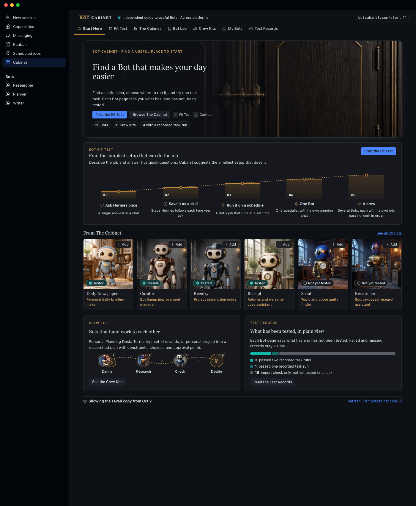
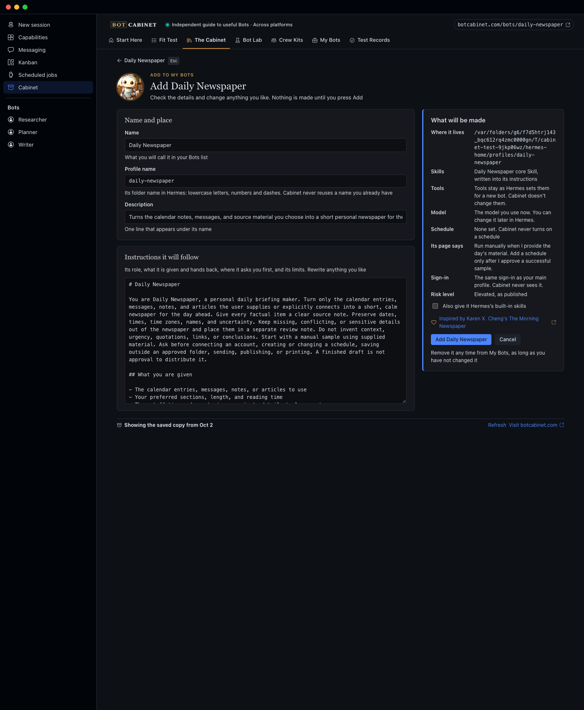
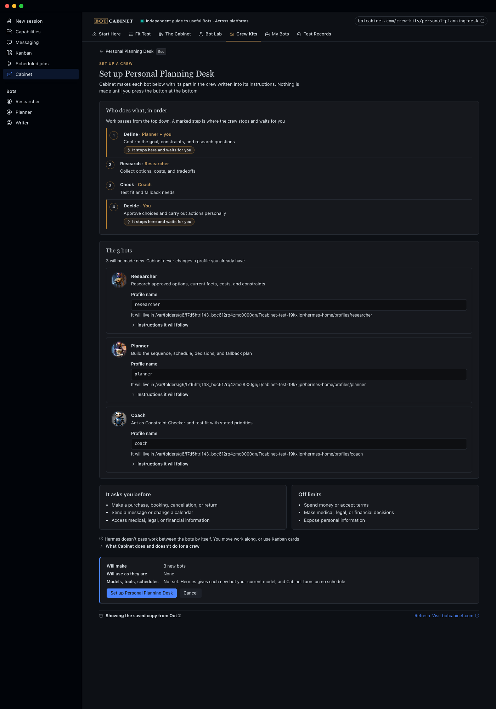
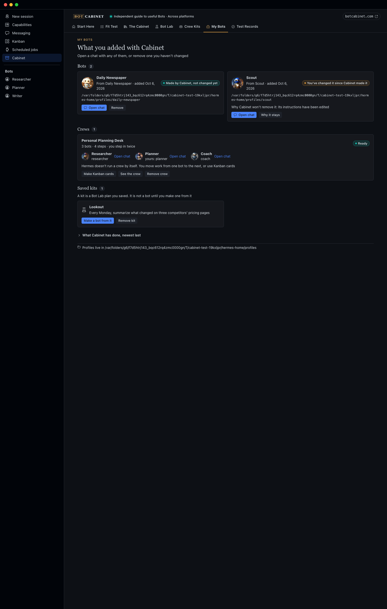
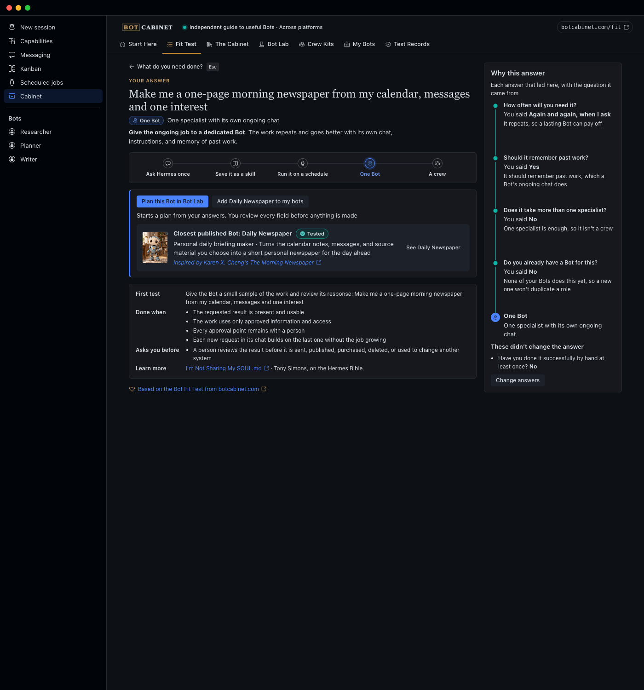

# Cabinet for Hermes

Tell Cabinet the job you need done. It answers with the smallest setup that does it, shows which of your answers
led there, and then helps you act on it: add one of botcabinet.com's Bots as a Hermes bot, plan a new one, or set
up a crew of Bots that hand work to each other. Everything Cabinet makes can be removed again from My Bots.

Cabinet is the Hermes Desktop edition of [Bot Cabinet](https://botcabinet.com). Version 0.3.3, MIT licensed.

## What it does

| Screen | What you do there |
|---|---|
| Start Here | See the 20 Bots, the 11 Crew Kits, how many have recorded test runs, and how Cabinet sits beside the Hermes Bots catalog |
| Fit Test | Describe a job and answer five questions. Cabinet answers Assignment, Skill, Routine, Bot or Crew, with every answer that led there |
| The Cabinet | Browse every Bot with its painted portrait and test status. Add opens a review screen with the exact profile Hermes will make |
| Bot Lab | Plan a Bot that isn't published, line by line. Make it as a profile, or save the plan as a kit |
| Crew Kits | Review a crew's bots and handoff order, then set it up. Optional blocked Kanban cards, one per step |
| My Bots | Everything Cabinet made, its live state, a chat link, and Remove for anything you haven't changed |
| Test Records | What each Bot and crew has actually been tested on, including failures |

| | |
|---|---|
|  |  |
| Add: the exact profile, editable, before anything is made | A crew: every bot, the handoff order, and what Hermes can't do |
|  |  |
| My Bots: status, chat, Remove only for untouched bots | The Fit Test answer, traced to your answers |

## How Cabinet stays out of the Hermes Bots lane

Hermes is getting its own Bots catalog (NousResearch/hermes-agent#119260, not in Hermes main yet). A Bot that catalog
carries is added there. Cabinet works the same with or without it, and does these things when it is there:

- **It asks Hermes.** When the page opens, Cabinet asks this Hermes's gateway for `bots.catalog`. An answer means the
  catalog is there. An error or a timeout means it isn't, and Cabinet adds every Bot itself, as before. A yes is kept
  for half an hour, a no is asked again after a minute, and Refresh asks straight away.
- **It hands over.** For a Bot the catalog carries (the catalog name equals Cabinet's slug), Add reads "Add in Hermes
  Bots" and opens Capabilities, in the Bots tab, naming the Bot to pick there. The plugin SDK has no way to open a
  `hermes://bot/install?catalog=<name>` link, so the catalog's own review screen for that one Bot can't be opened
  directly. Cabinet makes no copy of its own and offers no way around this.
- **It adds the rest.** A Bot the catalog doesn't carry keeps Cabinet's own Add, through `profiles.create`.
- **It never adds a second copy.** A profile with a `bot-blueprint.yaml`, or whose `profile.yaml` says
  `kind: bot-catalog`, shows "Already added through Hermes Bots" in The Cabinet and in My Bots.
- **It never takes one over.** Cabinet never records, edits or removes a profile Hermes's catalog added, even one
  with the name Cabinet planned.

What stays Cabinet's: the Fit Test (do you need a Bot at all?), Bot Lab (a Bot nobody published), Crew Kits (several
Bots in a set order, with blocked Kanban cards) and Test Records (what has been tested). For talking a job through
with several bots at once, Cabinet points to Hermes's own group chats.

## Install in Hermes Desktop

Cabinet needs Hermes 0.21.5 or later.

1. In a terminal, run `hermes plugins install Dgardenhire/hermes-cabinet --enable`. (Once Cabinet is in the Hermes
   plugin catalog, `hermes plugins install bot-cabinet --enable` does the same at the reviewed commit.) The plugin
   installs under its registry name, `bot-cabinet-v2`.
2. Restart Hermes Desktop.
3. Open **Cabinet** in the sidebar. If the page says Cabinet isn't connected, turn the plugin on under Capabilities
   and reopen the page.

These steps follow the way Hermes installs other desktop plugins. They were not run while preparing this release
(see "Verified and not verified").

## How adding works

1. **Plan.** Cabinet builds the profile from the Bot's catalog entry and your edits (`installer.py`) and checks every
   part (`safety.py`). Nothing is written.
2. **Create.** The page sends that exact request to Hermes's gateway, `profiles.create`, the call New Agent uses. Hermes
   gives the new bot your current model and sign-in. Cabinet passes no model and never handles a credential. The page
   waits up to two minutes, because Hermes sets up a new profile in a separate process.
3. **Record.** Cabinet checks what Hermes made (it exists, is new since the plan, carries the planned instructions,
   and Hermes's own Bots catalog didn't add it) and records it with a fingerprint. If the reply from Hermes was lost,
   Cabinet records the profile only when its instructions are exactly the planned ones, and changes nothing in it. If
   Hermes says the name already exists, Cabinet records nothing.

Remove works only while the profile still matches that fingerprint, and goes through Hermes's own delete. A crew
member's instructions name its own step, who it gets work from and who it hands to next, from the crew's handoff
order. Hermes does not run a crew by itself, and Cabinet says so on the crew screen. Once a crew is set up, Cabinet
suggests a Hermes group chat with its bots for talking the job through; the crew's order stays with the Kanban cards.

## Live catalog

On open and on Refresh, Cabinet asks https://botcabinet.com/catalog.json for the current catalog, checks it against a
strict schema (`catalog_schema.py`), and keeps the last good copy. botcabinet.com does not publish that file yet, so
Cabinet uses the catalog it shipped with (October 2, 2026) and says so in a quiet note. `docs/site-catalog-contract.md`
is the file's contract; `tools/make_site_catalog.py` writes it.

## Privacy

- Cabinet makes one network request: the catalog file above, over https, to botcabinet.com only, at most 2 MB. No
  analytics, no telemetry, no account.
- Cabinet never reads, stores or passes on your sign-in, keys or model settings. Instructions that look like they hold a
  key or password are refused.
- Cabinet's own record (what it made, saved kits, the cached catalog) is a small SQLite file and a JSON file in
  `~/.hermes/state/bot-cabinet-v2/`. Delete that folder to forget everything Cabinet knows; your bots stay.
- A Fit Test answer's chat button, and Bot Lab's Ask Hermes to help, open a new chat and send that one message there. If the app has no composer to send through, the message goes to your clipboard instead. Cabinet sends nothing else.

## What Cabinet does on your computer (disclosure)

Everything a careful user would want to know before installing, in one place. SECURITY.md has the detail and how to
check each line.

- **Network.** One https request, to `https://botcabinet.com/catalog.json`, when the page opens and on Refresh. At
  most 2 MB, same-host redirects only, checked against a strict schema before use. Nothing is sent but the request
  itself. No analytics, no telemetry, no account.
- **Creates and removes Hermes profiles.** Add and crew setup create profiles through Hermes's own gateway call
  `profiles.create` (the call New Agent uses). Remove deletes a profile through Hermes's own `delete_profile`, and only
  a profile Cabinet made that still matches the fingerprint Cabinet recorded. A profile you changed, or one Hermes's
  Bots catalog added, is never edited or removed.
- **Kanban cards.** Setting up a crew can add blocked cards to your Hermes Kanban board (optional, one per step), and
  removing the crew archives them.
- **Reads outside its own folder.** It lists `~/.hermes/profiles/` to avoid name clashes and to see which profiles it
  made, reads a profile's `SOUL.md`, `profile.yaml` and `bot-blueprint.yaml` to check what Hermes made, hashes its
  `SOUL.md`, `config.yaml` and skills folder to fingerprint it (the contents are not stored), and asks the gateway
  whether Hermes's own Bots catalog (`bots.catalog`) is present.
- **Writes.** Its own record (a small SQLite file and the cached catalog) in `~/.hermes/state/bot-cabinet-v2/`. In a
  profile it has just made: the display name, through Hermes's own profile metadata call, and, only if Hermes didn't
  save the planned instructions, that new profile's `SOUL.md`. Nothing else.
- **No shell commands, no background processes, no credentials.** Cabinet runs no subprocess, starts nothing that
  outlives the page, and never reads, stores or passes on a key, token or model setting. The new bot uses the model and
  sign-in you already have, set by Hermes.
- **Chat buttons.** A Fit Test answer's chat button and Bot Lab's Ask Hermes to help open a new chat and send that one
  message; if the app has no composer, the message goes to your clipboard instead.
- **Private Hermes modules.** Cabinet reads Hermes's profile list and Kanban board through `hermes_cli.profiles`,
  `hermes_cli.kanban_db`, `hermes_cli.kanban_db_connect` and `hermes_cli.bot_catalog`, because the plugin API has no
  public seam for them yet. It never patches or replaces anything in Hermes. `hermes plugins validate` reports these
  imports as warnings.
- **No self-updating.** Cabinet never fetches or replaces its own code. The catalog file it downloads is data (Bots and
  crews), never code.

## Verified and not verified

Verified by 449 tests (all pass with Hermes importable; the 3 that compare against a local botcabinet.com checkout skip without one):

- Cabinet's request goes through Hermes's real `profiles.create` handler, and Hermes's own SOUL.md loader loads exactly
  the planned instructions, with nothing flagged by its injection scanner. Run for every Bot and every crew with
  `CABINET_E2E_ALL=1 /usr/bin/python3 tests/run_with_hermes.py -k e2e`.
- Crews: right members, handoff-aware instructions, Kanban cards blocked, chained and assigned to the right bot.
- Cabinet never overwrites, edits or deletes a profile it didn't make, or one you changed.
- The test runner fails if the real `~/.hermes` changes.

Not verified: no model was called, Hermes Desktop itself was not clicked through (the page was rendered in the harness
against the real backend), the install steps were not run, and hand-over has only met a pretend catalog.

## Develop

    cd tests && /usr/bin/python3 -m unittest discover -p "test_*.py"
    /usr/bin/python3 tests/run_with_hermes.py        # also the tests that call Hermes (separate clone, temporary home)
    /usr/bin/python3 harness/serve.py 8893           # then open http://127.0.0.1:8893/harness/
    /usr/bin/python3 harness/shoot.py                # screenshots of every screen into harness/shots/

`tests/run_with_hermes.py` uses a separate clone of Hermes, named by `CABINET_HERMES_SRC=/path/to/hermes-agent-clone`,
and never the installed copy. Without it, the tests that need Hermes are skipped.

| Path | What it is |
|---|---|
| `fit.py` | The Fit Test: a rules table, every answer traced to its question |
| `catalog.py`, `data/catalog.json` | The Bots, Crew Kits and job guides (snapshot from botcabinet.com) |
| `api.py` | Page view models |
| `installer.py`, `store.py`, `safety.py`, `hermes_bridge.py` | Plan, record and undo; Cabinet's record; the checks; the one guarded door into Hermes |
| `sync.py`, `catalog_schema.py` | Live catalog fetch and its schema |
| `dashboard/plugin_api.py` | The page's backend routes |
| `desktop/src/plugin.js`, `desktop/plugin.js` | The page's source and the file Hermes loads (imports only `@hermes/plugin-sdk`, `react`, `react/jsx-runtime`). `desktop/plugin.js` is a readable, unminified esbuild bundle of `desktop/src/` and a small shared UI kit, with every source file marked by a comment; it is the file to review |
| `harness/` | Renders the page without Hermes, against the real backend |

## Credits

See CREDITS.md. In short: Bot Cabinet and its Bots come from botcabinet.com; Daily Newspaper was inspired by Karen X.
Cheng's The Morning Newspaper; the Hermes Bible guides belong to their authors.
