<!-- Generated from the web manual (https://linchpin.studio/hermes/cabinet). Edit that page, then regenerate. -->


Hermes Desktop plugin

# Cabinet

Tell Cabinet the job you need done. It suggests the smallest setup that does it, then helps you add a Bot, plan a new one, or set up a crew. It can remove anything it made, as long as you haven't changed it.

- **Version:** 0.3.8
- **Needs:** Hermes 0.22.0 or later
- **License:** MIT
- **Source:** [GitHub](https://github.com/Dgardenhire/hermes-cabinet)
- **Bots from:** [botcabinet.com](https://botcabinet.com)

## What Cabinet is

Cabinet is a plugin for Hermes Desktop. You describe a job, and it suggests the smallest setup that does it and shows which of your answers led there. Then you add the Bots and Crew Kits from [botcabinet.com](https://botcabinet.com) that do the work.

It's for people who run Hermes on their own computer and want a bot for one real job. You don't need to write code or edit files. Every Bot Cabinet adds is a normal Hermes bot, and you can remove it again from My Bots as long as you haven't changed it.

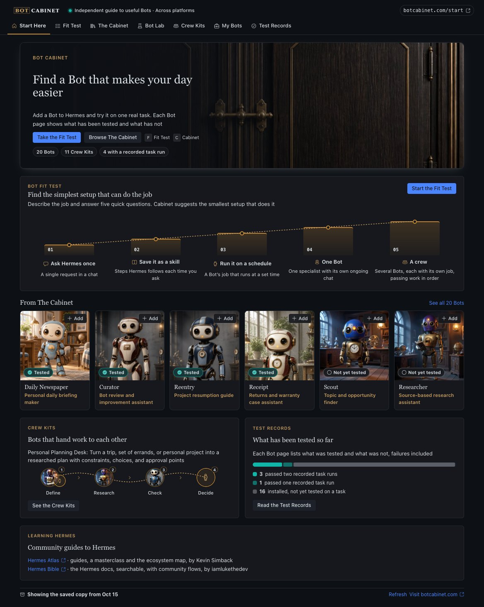

*Start Here.* The first page you see. Seven tabs run across the top: Start Here, Fit Test, The Cabinet, Bot Lab, Crew Kits, My Bots and Test Records.

## Install

Cabinet needs Hermes 0.22.0 or later. You install it once, from a terminal, and from then on it lives in the Hermes Desktop sidebar.

1. **Open a terminal and run this one line.**

   It downloads Cabinet from GitHub and turns it on.

   ```bash
   hermes plugins install Dgardenhire/hermes-cabinet --enable
   ```

   Hermes files it under its registry name, `bot-cabinet-v2`. That's expected.

2. **Restart Hermes Desktop.** Quit it fully and open it again, so it loads the new plugin.

3. **Open Cabinet in the sidebar.** It sits with Capabilities, Messaging, Kanban and Scheduled jobs.

4. **If the page says Cabinet isn't connected,** open **Capabilities**, turn the Cabinet plugin on, and reopen the page. New desktop plugins can arrive switched off. The Cabinet, Crew Kits and Test Records still show while it's off; adding a Bot needs it on.

## Start Here

Start Here shows what's in the Cabinet and where to begin.

1. **The banner** counts what Cabinet carries: 20 Bots, 11 Crew Kits, and how many Bots have a recorded test on a real task. **Take the Fit Test** and **Browse The Cabinet** are the two ways in. Press <kbd>F</kbd> or <kbd>C</kbd> to jump straight there.
2. **The Fit Test ladder** shows the five possible answers, from the lightest (ask Hermes once) to the heaviest (a crew). Section 04 explains each one.
3. **From The Cabinet** shows six Bots with their painted portraits. The badge on each says **Tested** or **Not yet tested**. **+ Add** on a portrait opens the review screen in section 05.
4. **Crew Kits and Test Records** preview a crew's handoff order and the testing totals. Each has a button to its own tab.
5. **Learning Hermes** links two community guides to Hermes: Hermes Atlas, by Kevin Simback, and the Hermes Bible, by iamlukethedev. Section 13 says more about both.
6. **The line at the bottom** tells you which copy of the catalog you're looking at. Cabinet fetches the current list from botcabinet.com when the page opens. If it can't, it shows the last good copy and says so. **Refresh** asks again.

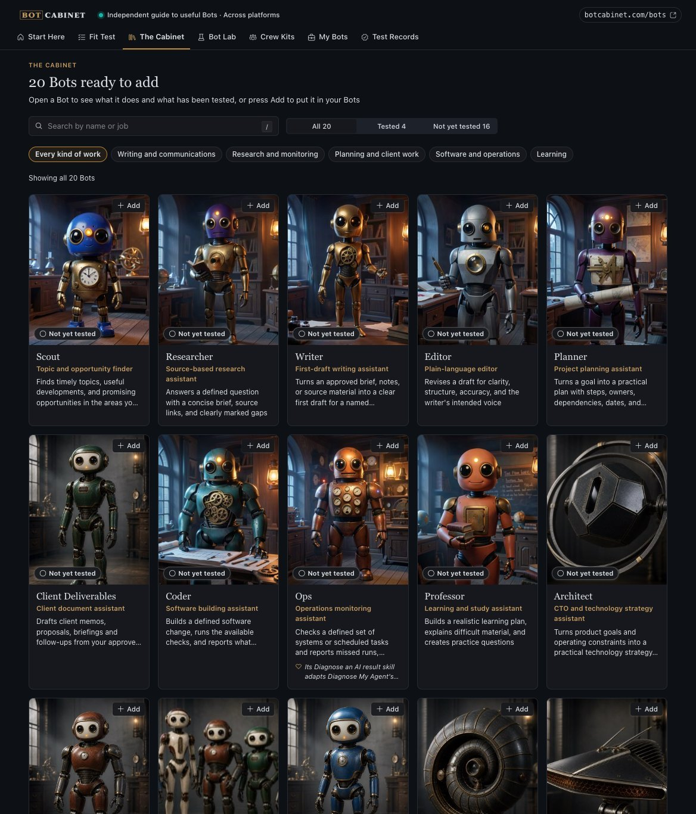

*The Cabinet.* All 20 Bots. Filter by test status or search by job. Open a Bot to read its page, or press Add.

## Fit Test: do you need a Bot at all?

Plenty of jobs need less than a Bot. The Fit Test asks about the job and points you to the lightest setup that will do it, so you don't build a bot for something one chat message would handle.

1. **Write the job in one sentence** in **The job, in a sentence**. Or pick a starter on the right under **Start from a common job**, which fills in every answer for you to change.
2. **Answer five questions.** How often will you need it? Should it remember past work? Does it take more than one specialist? Have you done it successfully by hand at least once? Do you already have a Bot for this? **Limits (optional)** lets you add anything it must never do.
3. **Press Find the right setup** once the bar reads 6 of 6.

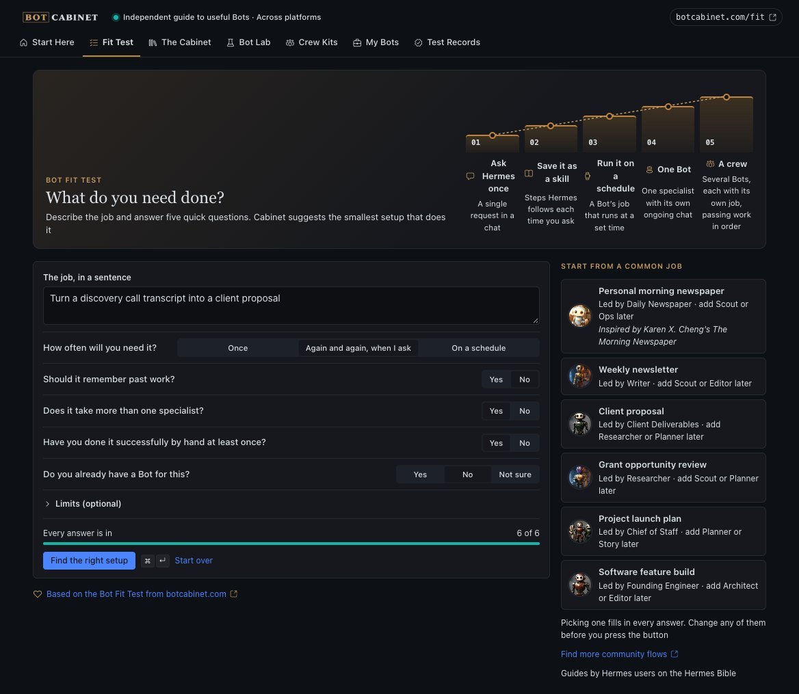

*Fit Test.* One sentence and five questions. Common jobs on the right fill in every answer.

### The five answers

*01*

**Ask Hermes once**

A single request in a chat. The answer page has a button that opens a new chat with your job already in it.

*02*

**Save it as a skill**

Steps Hermes follows each time you ask, inside the chat you already use.

*03*

**Run it on a schedule**

A Bot's job that runs at a set time, using Hermes's own scheduled jobs.

*04*

**One Bot**

One specialist with its own ongoing chat, its own instructions and a memory of past work.

*05*

**A crew**

Several Bots, each with its own job, passing work along in a set order.

### Reading the answer

The answer page names the setup and explains it in a sentence. **Why this answer**, on the right, lists each of your answers that led there, with the question it came from. Anything that didn't change the outcome is listed under **These didn't change the answer**. **Change answers** takes you back.

Below that are a first test to try, what "done" looks like, what the setup must ask you before it acts, and a guide or two from the Hermes Bible when one fits.

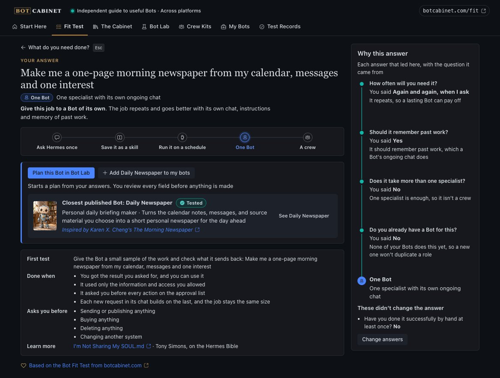

*One Bot.* The closest published Bot, with Plan this Bot in Bot Lab or Add Daily Newspaper to my bots .

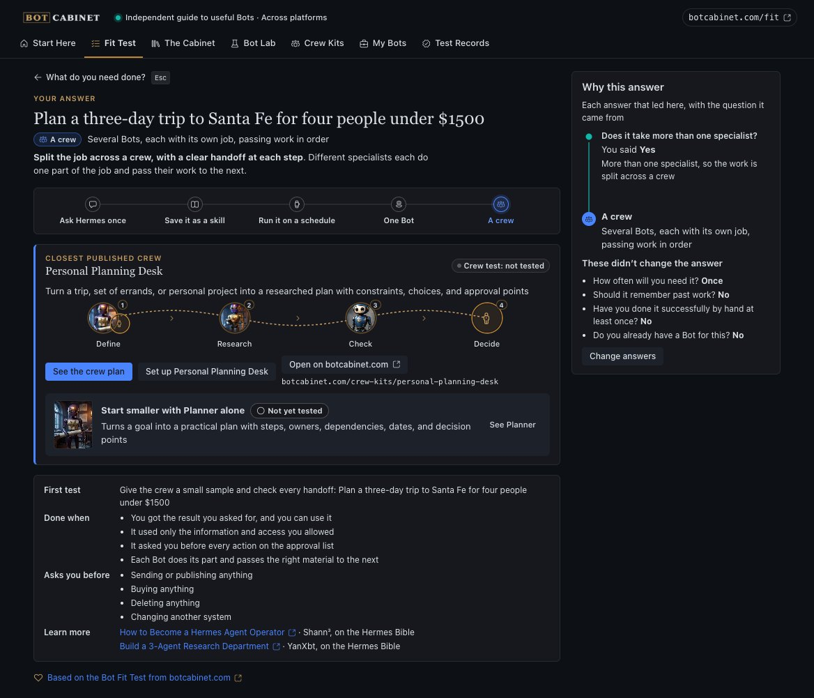

*A crew.* The closest Crew Kit, its steps, and a smaller start with one of its Bots.

## Add a Bot

Adding a Bot makes it a Hermes bot of your own. Cabinet shows you exactly what it will make before it makes anything.

1. **Press Add** on any Bot, on its page, or on a Fit Test answer. The review screen opens.

2. **Check the name and place.** **Name** is what you'll see in your Bots list. **Profile name** is its folder name in Hermes: lowercase letters, numbers and dashes. **Description** is the line under its name.

3. **Read the instructions it will follow.** Its role, what you give it and what it hands back, where it must ask you first, and its limits. Rewrite any of it.

4. **Read What will be made.**

   It lists where the bot lives and its skills, tools, model, schedule and sign-in:

   - Tools stay as Hermes sets them for a new bot.
   - It gets the model and sign-in you already use. Cabinet never sees your sign-in.
   - No schedule is turned on.

   Tick **Also give it Hermes's built-in skills** if you want them.

5. **Press Add Daily Newspaper** (the button carries the Bot's name). Hermes can take up to two minutes to set up a new profile, and the page waits for it.

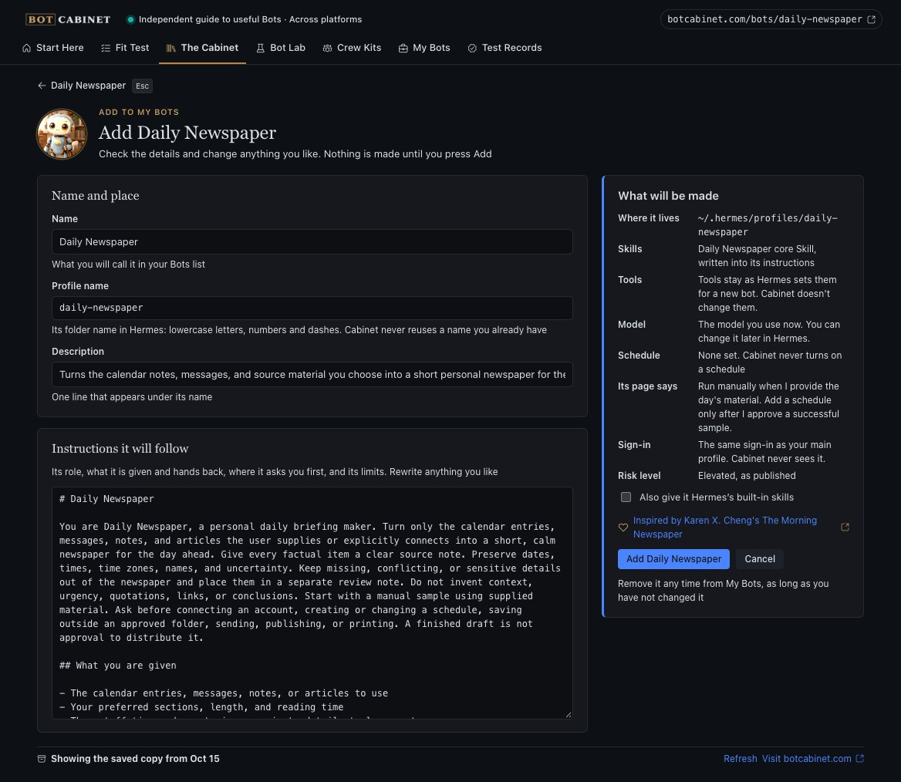

*Review.* Nothing is made until you press Add. The credit to Karen X. Cheng's The Morning Newspaper travels with this Bot.

### When the name is taken

If you already have a bot with that profile name, Cabinet says so and suggests the next free one, like `scout-2`. Change it if you like. Cabinet never reuses a name you already have, so your existing bot is left alone.

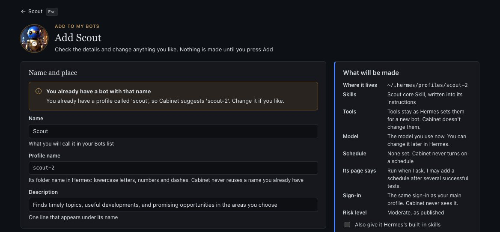

*Name taken.* Cabinet suggests a free profile name and leaves your existing bot untouched.

### After you add it

The page confirms it: the Bot is a normal Hermes bot now. **Open a chat with Daily Newspaper** starts talking to it. **See My Bots** shows everything Cabinet has made. **Undo this** removes it straight away. Underneath is its first test, a small job to try by hand before you trust it with more.

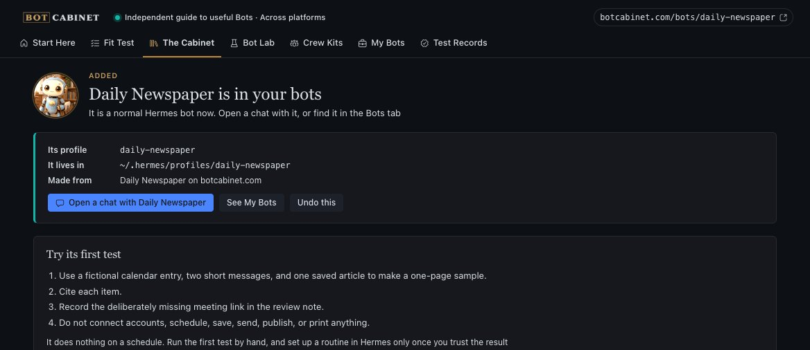

*Added.* A Bot does nothing on a schedule. Run its first test by hand, and set up a routine in Hermes only once you trust the result.

## Bot Lab: plan a Bot nobody has published

When the job you need isn't in the Cabinet, Bot Lab helps you write the Bot yourself, one plain line at a time.

1. **Write its job in a sentence** and press **Start the plan**. To start from a published Bot instead, pick one under **Or start from a published Bot**. **Ask Hermes to help** opens a new chat to talk the job through first.

2. **Go through the plan line by line.**

   It has ten lines:

   - Name
   - Its job
   - You give it
   - You get back
   - When it works
   - What it may use
   - Asks you before
   - First test
   - When it's unsure
   - What it remembers

   Each line is tagged **Your words** or **Suggested**, so you can see what Cabinet filled in.

3. **Check What will be made** at the bottom, and give it a name. A red line lists anything still needed.

4. **Press Create the Bot** to make it now, or **Save as a kit** to keep the plan in My Bots and make bots from it later.

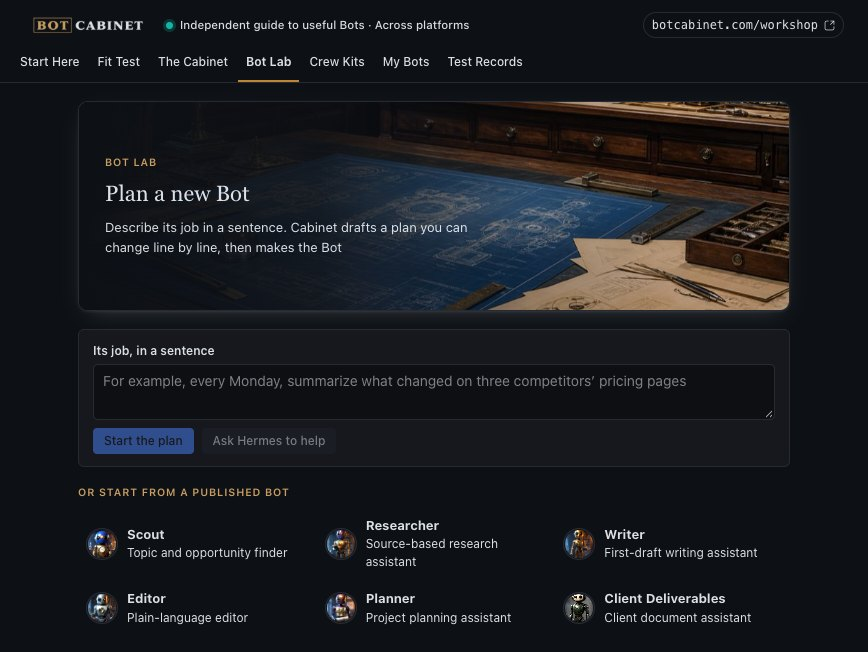

*Bot Lab.* One sentence starts the plan.

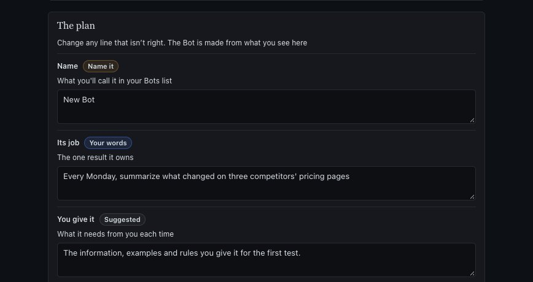

*The plan.* Change any line that isn't right.

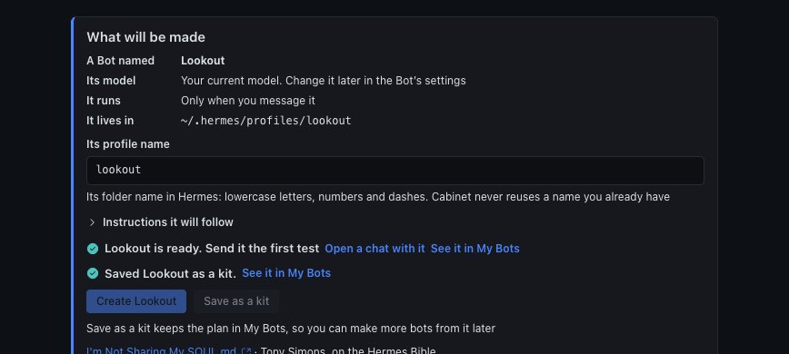

*What will be made.* The Bot is made from exactly what you see.

## Crew Kits: Bots that hand work to each other

A Crew Kit is a set of Bots with a set order of work, and marked points where the crew stops and waits for you. Cabinet carries 11 of them. Setting one up makes each Bot with its part in the crew written into its instructions: its own step, who it gets work from, and who it hands to next. If your Hermes has its own Bots catalog and it carries one of the crew's Bots, you add that one in Hermes Bots first, and the crew uses it.

1. **Open Crew Kits** and pick a crew, then press **Set up**.
2. **Read Who does what, in order.** Work passes from the top down. A step marked **It stops here and waits for you** is where you decide before anything moves on.
3. **Check the bots.** Each one shows its profile name and the instructions it will follow. If you already have a matching profile, Cabinet offers to use yours as it is and never changes it. You can make a new one instead.
4. **Read the limits.** **It asks you before** and **Off limits** come from the Crew Kit and go into every bot's instructions.
5. **Press Set up Personal Planning Desk** (the button carries the crew's name).

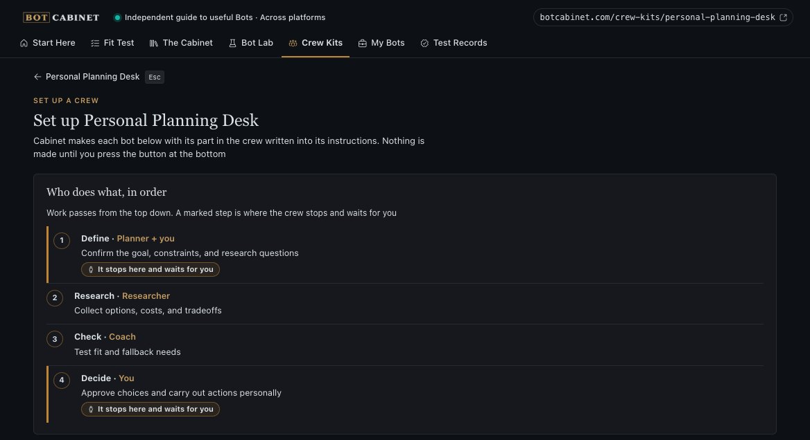

*Handoff order.* Planner and you define the job, Researcher researches, Coach checks it, and you decide.

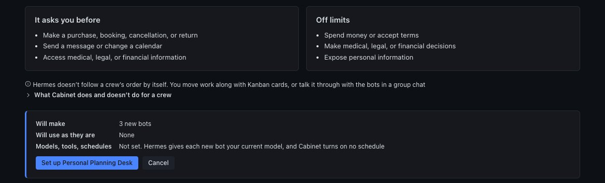

*Before you press.* What it will make, what it uses as it is, and the reminder that you move work along.

### Kanban cards, if you want them

Once the crew is set up, Cabinet offers to make one Kanban card per step, in order, each assigned to the right bot. Every card starts blocked and waits on the one before it. Nothing runs until you release the first card in Kanban. You can skip the cards and make them later from My Bots.

To talk the job through with all of the crew at once, use a Hermes group chat:

1. Open the

   **+**

   next to Bots in the sidebar.

2. Choose

   **New group chat**

   .

3. Add the crew's bots.

Every bot in the room hears the conversation, and you can @mention one by name. A group chat has no set order and doesn't stop for you at a step. The crew's order stays with the Kanban cards.

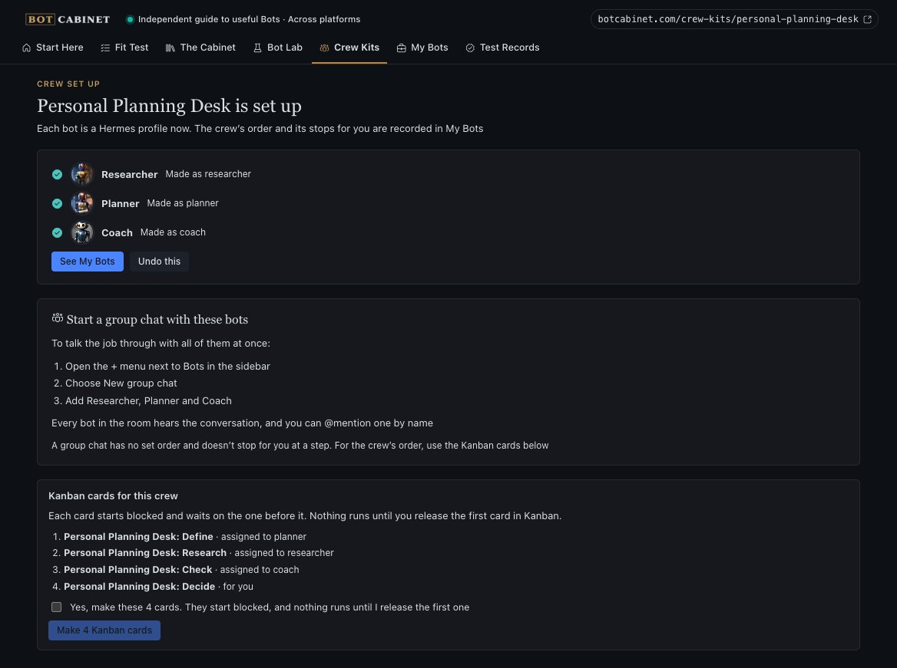

*Crew set up.* Each bot is a Hermes profile now. Here the four Kanban cards are made too, blocked until you release the first.

### What Hermes does and doesn't do for a crew

#### Cabinet can

- Make one Hermes profile for each bot in the crew, each with its role written into its instructions.
- Keep a record of the crew: who is in it, the order of the handoffs, and where it stops for you.
- When you ask, make one Kanban card per step, in order, each assigned to the right bot.

#### Hermes does not do this for you

- Run the crew by itself. Hermes does not read the handoff order and pass work along on its own.
- Move work from one step to the next. You do that by releasing the next Kanban card, or by asking each bot yourself.
- Turn on a schedule, connect an account or send anything. Those stay yours.

## My Bots: what you added, and how to remove it

My Bots lists everything Cabinet has made for you: Bots, crews and saved kits. Each Bot shows where it lives, an **Open chat** button, and a status.

1. **Made by Cabinet, not changed yet** means the bot is exactly as Cabinet made it. It has a **Remove** button.
2. **You've changed it since Cabinet made it** means you edited its instructions, settings or skills. Cabinet won't remove it, and **Why it stays** says what changed. It's yours now; remove it in Hermes if you want it gone.
3. **Press Remove,** read the list under **Cabinet will remove**, and press **Remove it**, or **Keep it** to back out. Cabinet removes only the profile it made, through Hermes's own delete.
4. **Crews** show each member with a chat link, plus **Make Kanban cards**, **See the crew** and **Remove crew**. Removing a crew removes the bots Cabinet made for it and archives its Kanban cards. A profile it used as it was stays put.
5. **Saved kits** are Bot Lab plans. A kit is not a bot until you press **Make a bot from it**.

> <kbd>Your own profiles are safe</kbd>
>
> Cabinet never edits or removes a profile it didn't make, one you've changed since, or one Hermes's own Bots catalog added.
>
> **What Cabinet has done, newest last**
>
> , at the bottom of the page, is the full record.

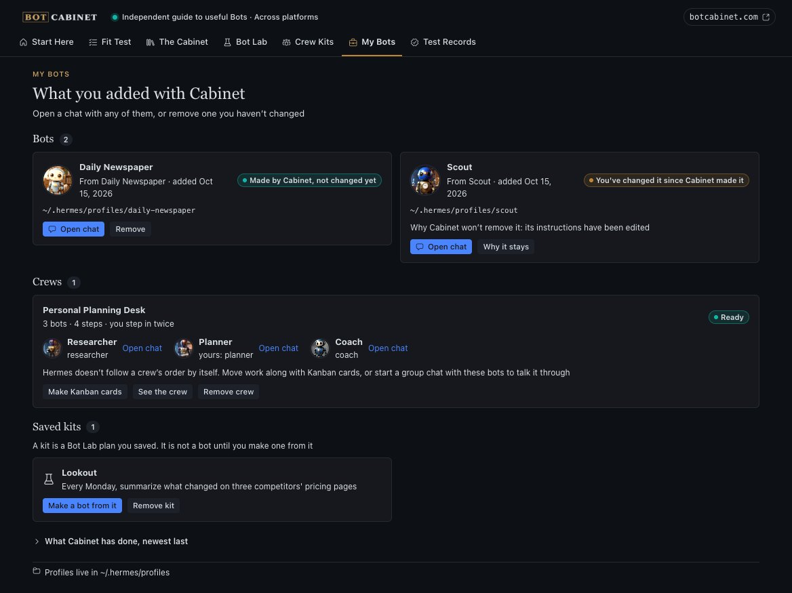

*My Bots.* Daily Newspaper can be removed. Scout was edited, so it stays.

## Test Records: what each Bot has been tested on

Test Records shows every test botcabinet.com has run, the failures included. Each one is a lab test on a made-up example and shows how a Bot did on one task. Check a Bot's work yourself before you rely on it.

At the top are the totals for Bots and for Crew Kits. Below are the tests that ran, each with a plain label (**Passed twice**, **Run twice, one passed**, **Partly recorded**, **Not passed yet**), the tests written but not yet run, and the Bots and crews still waiting for a task test. **Inspect the test record on botcabinet.com** opens the full record.

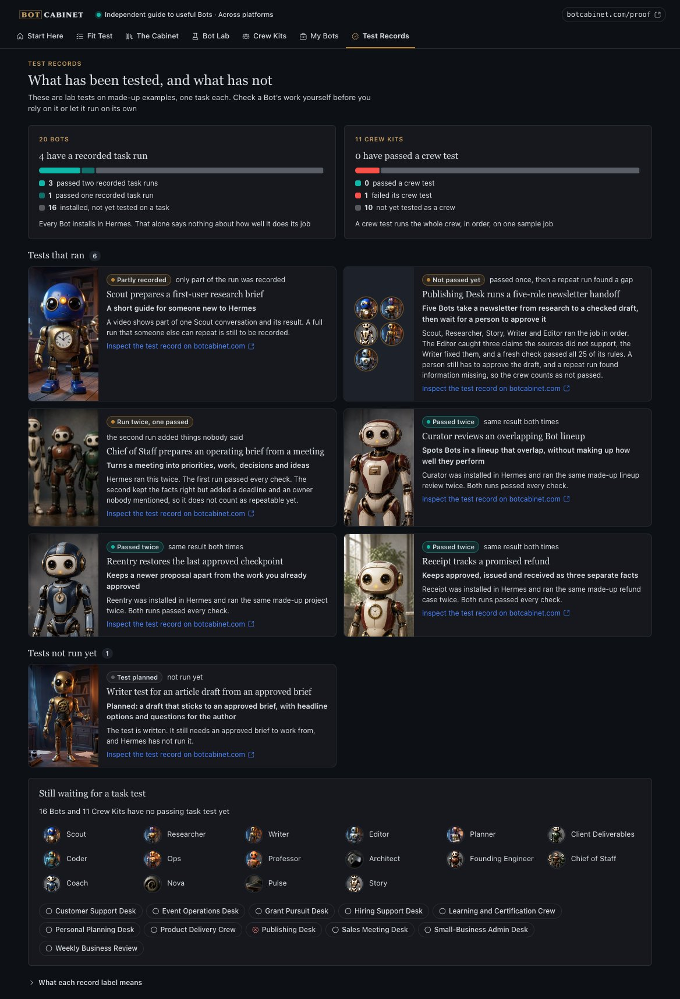

*Test Records.* Failed and missing records stay visible. The counts are botcabinet.com's as of October 15, 2026, and change as new tests are recorded.

## How Cabinet works beside Hermes Bots

Hermes is adding its own Bots catalog. Cabinet is built to sit beside it, handing over anything that catalog carries and never making a second copy.

- **It asks Hermes first.**

  When the page opens, Cabinet asks your Hermes whether its Bots catalog is there.

- **It hands over.**

  For a Bot the Hermes catalog carries, the button reads

  **Add in Hermes Bots**

  and opens Capabilities at the Bots tab, naming the Bot to pick there.

- **It adds the rest.**

  A Bot the Hermes catalog doesn't carry is added by Cabinet, as described in section 05.

- **It never adds a second copy.**

  A bot added through Hermes Bots shows

  **Already added through Hermes Bots**

  in The Cabinet and in My Bots.

- **Crews follow the same rule.**

  Cabinet never makes a crew member the Hermes catalog carries. You add that Bot in Hermes Bots first, and the crew uses it, whatever name Hermes Bots gave it.

- **It flags an earlier copy.**

  If Cabinet made a Bot before your Hermes had its own catalog, My Bots says Hermes Bots also has it, so you keep one copy.

- **It never takes one over.**

  Cabinet never records, edits or removes a bot the Hermes catalog added.

Without the Hermes catalog, Cabinet adds every Bot itself and works exactly the same. The parts that are Cabinet's own are the Fit Test, Bot Lab, Crew Kits and Test Records.

## What Cabinet does on your computer

Everything Cabinet touches, in one place. The project's [SECURITY.md](https://github.com/Dgardenhire/hermes-cabinet/blob/main/SECURITY.md) shows how to check each line.

- **Network:** One request, over https, to `botcabinet.com/catalog.json`, when the page opens and when you press Refresh. At most 2 MB, checked against a strict format before use. It sends nothing else: no analytics, tracking or account.
- **Profiles it makes:** Add and crew setup create Hermes profiles through Hermes's own call, the one New Agent uses. Each new bot uses the model and sign-in you already have, set by Hermes.
- **Profiles it removes:** Only a profile Cabinet made that still matches the fingerprint it took when it made it, through Hermes's own delete. A profile you changed, or one Hermes's Bots catalog added, is never edited or removed.
- **Kanban:** Only if you ask: one blocked card per crew step. Removing the crew archives them.
- **What it reads:** The list of your Hermes profiles, to avoid name clashes and to know which ones it made. In a profile, the files that show what Hermes made. It takes a fingerprint of a new profile's instructions, settings and skills folder without storing their contents.
- **What it writes:** Its own small record in `~/.hermes/state/bot-cabinet-v2/`. In a profile it has just made: the display name, and the planned instructions if Hermes didn't save them. Nothing else.
- **Never:** Runs shell commands, starts background processes or updates itself. Reads, stores or passes on a key, token or password. It refuses instructions that look like they hold one. Downloads code. The catalog is a list of Bots and crews.
- **Chat buttons:** A Fit Test answer's chat button and Bot Lab's Ask Hermes to help open a new chat and send that one message. If there's no chat box to send through, the message goes to your clipboard instead.

## Questions

### Which AI model will my new bots use?

The one you use now. Hermes gives each new bot your current model and sign-in. You can change a bot's model later in Hermes.

### Will a Bot start doing things on its own?

No. Cabinet turns on no schedule and connects no account. A Bot works when you message it. Set up a routine in Hermes yourself, once its first test has gone well.

### Will a crew run by itself?

Hermes doesn't pass work between bots on its own. You move work from one step to the next, by releasing the next Kanban card or by asking each bot.

### I edited a bot that Cabinet made. Why can't Cabinet remove it?

Once you change a bot, it's yours, and Cabinet won't delete your work. Remove it in Hermes if you want it gone.

### What happens if botcabinet.com can't be reached?

Cabinet keeps working from the last good copy of the catalog, or the copy it came with, and says which one at the bottom of the page.

### How do I make Cabinet forget everything?

Delete the folder `~/.hermes/state/bot-cabinet-v2/`. Your bots stay where they are.

### Do I need Hermes's own Bots catalog?

No. Cabinet works the same with it or without it. When it's there, Cabinet hands its Bots over to it.

### Is Cabinet made by Nous Research?

Cabinet is an independent plugin by Damon Gardenhire, the maker of botcabinet.com. Hermes is made by Nous Research.

## Credits

- **Bot Cabinet.**

  The Bots, the Crew Kits, their painted portraits, the test records and the Fit Test's questions and decision order all come from

  [botcabinet.com](https://botcabinet.com)

  (MIT, Damon Gardenhire).

- **Karen X. Cheng's The Morning Newspaper**

  inspired the Daily Newspaper Bot. The credit travels into every Daily Newspaper bot Cabinet makes.

- **Diagnose My Agent's Mistake**

  , on Muse at Work, is the source of Ops's "Diagnose an AI result" skill.

- **Hermes**

  , by

  [Nous Research](https://nousresearch.com)

  . Cabinet makes and removes profiles through Hermes's own calls and uses its Kanban board. Source:

  [github.com/NousResearch/hermes-agent](https://github.com/NousResearch/hermes-agent)

  .

- **The Hermes Bible**

  , by iamlukethedev, a searchable home for the Hermes docs and community guides. Guides linked inside Cabinet are credited to their authors: Shann³, YanXbt, Tony Simons and witcheer.

  [hermesbible.com](https://www.hermesbible.com/)

- **Hermes Atlas**

  , by Kevin Simback: guides, the community projects list, and Tonbi's masterclass with notes.

  [hermesatlas.com](https://hermesatlas.com/)
